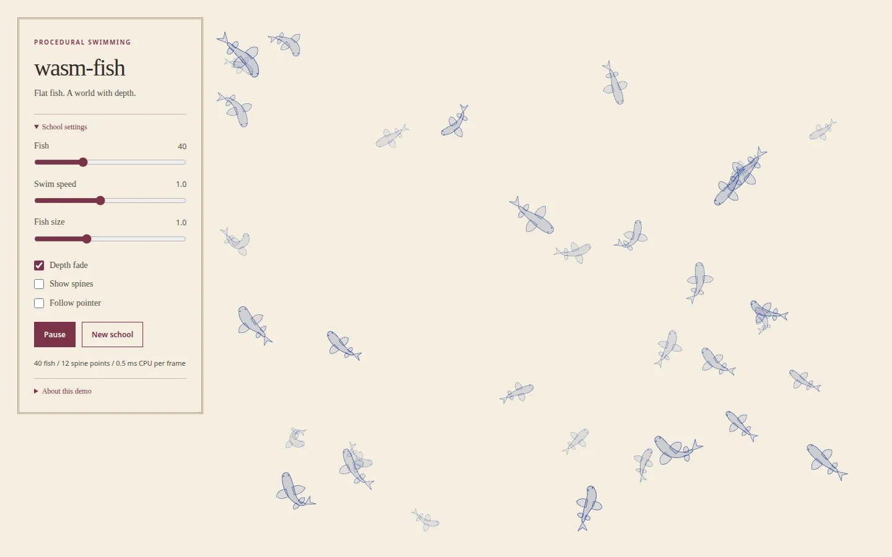

# wasm-fish

Procedural 2D fish with 3D schooling, written in C and compiled to WebAssembly.

The body starts from the constrained-point idea in `js-animals`.
The chain solver and body-width profile use Argonaut's cleaner method.
The movement core comes from `opengl_flock`.
See [source credits and licenses](THIRD_PARTY_NOTICES.md).



## Run the demo

Install [Emscripten](https://emscripten.org/docs/getting_started/downloads.html) and activate its shell environment.
The build is tested with Emscripten 7.0.0.

```sh
make wasm
make serve
```

Open http://127.0.0.1:8090/.
You can also pass the compiler path with `make wasm EMCC=/path/to/emcc`.
The generated `web/fish.js` and `web/fish.wasm` files are ignored by git.
GitHub Actions also builds these files.
Download its `wasm-fish-web` artifact to try the compiled demo without a compiler.
Unzip it and serve its `web` directory with a local HTTP server.

## Controls

- Fish count: 1 to 128. The defaults are 40 on desktop and 16 on mobile.
- Swim speed: changes simulation time, including body motion.
- Fish size: changes the rendered size and obstacle clearance.
- Depth fade: changes size and color with the fish's Z position.
- Show spines: shows the 12 constrained points and links.
- Follow pointer: guides the school toward the pointer.
- Pause and New school: pause movement or generate another seeded school.

Mobile controls start closed to leave more space for the fish.
Reduced-motion mode starts paused.
The demo pauses when the page is hidden.

## How it works

Each fish has one 3D boid and one 2D body.
The boid moves the head through X, Y, and Z.
The body follows the head in the drawing plane.
Adjacent spine points stay a fixed distance apart and bend by at most 22.5 degrees.
The first ten points define the body width.
The last two guide the tail.

The renderer builds a smooth outline, fins, eyes, and a forked tail from those points.
It draws the shapes in one batched WebGL 2 triangle call.
The canvas background is transparent.
Depth changes size, color, and draw order.
The bodies are opaque, so a near fish covers a fish behind it.
This is not a perspective camera or a solid 3D fish mesh.

The fins are thin, curved blades with a spine of fixed-length segments.
Their angles use head turn rate, swim speed, and body length.
The base and tip have separate damped motion.
The tip follows changes at the base after a short delay.
The front pectoral fin on the inside of a turn opens out.
The outside fin folds back toward the body.
A smaller turn radius causes a larger difference between the two fins.
The rear pelvic fins make smaller movements after a short delay.
Both pairs return smoothly toward their straight swimming pose.
Tighter turns bend the blade along its length.
The renderer fills each blade with a triangle strip along its spine.
This keeps the fill inside the curved edges when a fin folds back.
All fin motion and geometry run in C/WASM.

This is a simple motion model, with inspiration from studies of
[pectoral fins during turns](https://bpb-us-e1.wpmucdn.com/sites.harvard.edu/dist/6/58/files/2022/03/Lauder.et_.al_.BB_.2006.pdf)
and [pelvic fins during maneuvers](https://pubmed.ncbi.nlm.nih.gov/18775930/).
It does not model the water forces on the fins.

The simulation runs at a fixed 60 steps per second.
Each step reads a shared snapshot of the school.
Depth sorting changes draw indices rather than moving fish between slots.
This keeps every fish attached to its own body history.
The seed controls the initial positions, body lengths, widths, and swimming phases.

## Checks

```sh
make test
make sanitize
# Start make serve in another terminal before browser checks.
node scripts/check-demo.mjs
node scripts/check-demo.mjs http://127.0.0.1:8090/ 390 844
node scripts/check-demo.mjs http://127.0.0.1:8090/ 390 844 reduce
```

Native checks exercise joint distances, bend limits, frame-rate independence,
pause, depth order, count limits, resize, reset, and obstacle steering.
Fin checks exercise left and right turns, turn radius, blade width,
tip curvature, rapid turn reversals, mesh winding, and the return to straight swimming.
Browser checks need Node.js 22+ and Google Chrome.
They exercise the compiled WASM through the demo controls.
Captures are written to `build/`.
The CPU time label measures the C simulation and draw submission.
It does not measure the complete GPU frame time.

## Integration boundary

### Spaces package

[Open the Spaces demo](https://chatgpt.com/space/page_9bf34313dac88191a1a73e5891059dca).

`make spaces` writes `build/wasm-fish-spaces.html`.
This file includes the compiled WASM bytes and needs no external asset requests.
It fits the Page embed limit of 256 KiB.
The C/WASM engine is the same engine used in the standalone demo.
The Page version also saves control choices in widget state.

### Standalone module

The original flock repo and the Nereus site are separate from this project.
This demo does not deploy or change either one.

The module factory is `createFishSchool({canvas})`.
Use a canvas with `id="canvas"` and a defined CSS size.
The module exposes `_resize_canvas`, `_set_count`, `_set_speed`, `_set_scale`,
`_set_debug`, `_set_depth`, `_set_palette`, `_set_paused`, `_set_follow`, `_set_pointer`,
`_reset_school`, `_set_obstacle`, and `_clear_obstacles`.
Coordinates use CSS pixels.
The device pixel ratio is capped at 2 for the drawing buffer.

`_set_palette(inkRGB, paperRGB, strength)` sets the colors for an embedded school.
Pass colors as packed RGB integers, such as `0x1d3d8f`.
The body color strength ranges from 0 to 1. The demo default is 0.58.
Use 1 for full ink color on the nearest fish.
Depth still makes distant fish lighter. Body opacity stays at 1.
Pointer following starts disabled. An embedding page can leave it disabled
and omit pointer position updates.

Obstacle rectangles use the original flock integration pattern.
They add soft steering with clearance for the fish body.
They are not a hard collision solver.

## Source layout

- `fish.c`: body chain, width profile, and turn-driven fins.
- `school.c`: fixed-step school state, boundaries, and rectangle avoidance.
- `particle.c`, `vector3d.c`, `spatial_grid.c`: flock core.
- `main_wasm.c`: WebGL renderer and exported browser controls.
- `web/`: plain HTML, CSS, and JavaScript demo.
- `tests/`: native behavior checks.
- `scripts/`: browser behavior checks.
